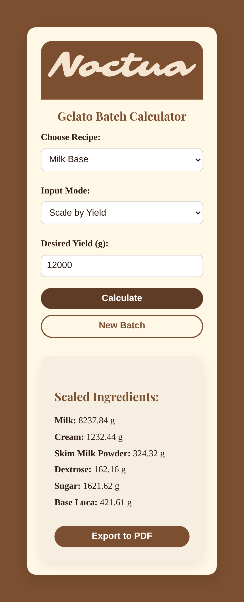

# Gelato Batch Calculator

A batch-sheet calculator built for Noctua, a gelato shop. Kitchen staff pick a base recipe, enter how much gelato they need, and get every ingredient scaled in grams. The batch sheet can be exported as a PDF and printed for the production table.



## What it does

- **Scale by yield.** Enter the total batch weight you want (for example 12,000 g) and every ingredient scales to match.
- **Scale by ingredient.** Short on something? Pick the ingredient and how much you have, and the rest of the recipe scales around it.
- **Export to PDF.** Generates a dated batch sheet with the recipe, the input used, and the scaled ingredient list.
- Works on a phone or tablet at the counter.

## Why I built it

I spent 15 years in professional kitchens. Scaling a base recipe by hand with a calculator is slow and easy to get wrong, and a wrong ratio ruins a whole batch. This app makes each batch sheet consistent and printable.

## Tech

React 19 · Vite · jsPDF · plain CSS

## Run it

```bash
npm ci
npm run dev      # http://localhost:5173
npm run build    # production build in dist/
```

## How the scaling works

Each recipe stores its ingredient weights and a base yield. The app computes one scale factor and applies it to every ingredient:

- by yield: `factor = desired yield / base yield`
- by ingredient: `factor = amount available / that ingredient's recipe amount`

Recipes live in `src/App.jsx`.

## What I'd add next

- Edit and save recipes in the app instead of in code
- Unit tests for the scaling math
- Deploy a public demo
